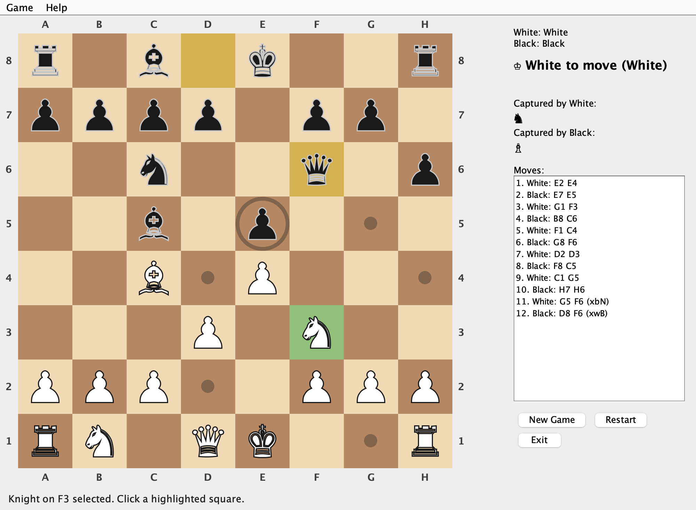

# TeamAnime — Chess (Swing GUI + Console)

Class: CS 3354 (Object-Oriented Design and Programming), Phase 2
Team Members: Alexander Matos

## Purpose
A two-player chess game for the desktop. Phase 1 built a console version: players typed moves like `E2 E4`, and the game enforced each piece's movement rules. Phase 2 reuses that back end and adds a Java Swing interface, the full rules of chess (check, checkmate, stalemate, castling, en passant, and promotion), and a computer opponent.

All chess rules live in the back end (`chess.model`, `chess.pieces`, `chess.service`). The Swing window and the console only turn user actions into calls on `Game`, so both interfaces share the same rules.

Intended users: anyone who knows how to play chess or is learning. Two people can play on the same computer, or one person can play against the computer. Illegal moves are rejected with an explanation, so it also helps beginners learn the rules.



## Requirements
- Java **17 or newer** (developed and tested on JDK 26)
- macOS or Linux shell for the scripts, or the plain `javac`/`java` commands below (these work on Windows too)
- No build tool or internet connection needed. JUnit is included in `lib/`.

## Build and run
```bash
./scripts/gui.sh                   # build and start the Swing GUI (main entry point)
./scripts/run.sh                   # build and start the console version (optional: ./scripts/run.sh Alice Bob)
./scripts/test.sh                  # run the JUnit test suite (98 tests)
./scripts/demo.sh                  # run the labeled scenario checks (159 checks)
./scripts/build.sh                 # compile only, to out/
./scripts/javadoc.sh               # generate docs/api/index.html
./scripts/count_loc.sh             # count nonblank, non-comment lines
```
Without the scripts:
```bash
javac --release 17 -d out $(find src -name '*.java')
java -cp out chess.gui.ChessGuiApp       # GUI
java -cp out chess.console.ChessApp      # console
```

## Entry points
| Class | Purpose |
|---|---|
| `chess.gui.ChessGuiApp` | Swing GUI (main application) |
| `chess.console.ChessApp` | Console version from Phase 1, updated for the full rules |
| `chess.console.DemoDriver` | Non-interactive driver that runs labeled scenarios and prints PASS/FAIL |

## How to play (GUI)
- **Move a piece:** click it, then click a highlighted square, or drag it and drop it on the square. Dots mark empty squares you can move to, and rings mark pieces you can capture.
- **Deselect:** click the selected piece again, or click another of your own pieces to switch.
- **New Game** (menu or button, ⌘N / Ctrl+N): choose two players or a game against the computer, enter names, and pick the computer's color and difficulty.
- **Restart** (⌘R / Ctrl+R) starts the same setup again. **Exit** (⌘Q / Ctrl+Q) asks before closing.
- **Help → How to Play** summarizes the controls.
- The side panel shows whose turn it is, check and game-over status, captured pieces, and the move list. The bar at the bottom explains the result of each action, including why a move was rejected.

## Completed features
### Board and display
- 8×8 board with A–H and 1–8 labels on all sides, light and dark squares, and distinct white and black piece symbols.
- Clear turn indicator, plus highlights for the selected piece, its legal moves, the last move played, and a king in check (red).
- The window can be resized, and the board scales with it.

### Rules (validated in the back end)
- Movement and capture rules for all six pieces, including blocked paths and the knight's jump.
- **King safety:** a move that leaves your own king in check is rejected, including moving a pinned piece.
- **Check** is announced; **checkmate** and **stalemate** end the game with a message, and no further moves are accepted.
- **Castling** on both sides. It is refused if the king or rook has moved, a piece is in the way, the king is in check, or the king would pass through or land on an attacked square.
- **En passant**, allowed only on the move right after the enemy pawn's two-square advance.
- **Pawn promotion** with a choice of queen, rook, bishop, or knight. Cancelling the dialog cancels the move.
- Built-in check from the assignment: F2–F3, E7–E5, G2–G4, D8–H4 ends in checkmate with a win for Black.

### Input validation and errors
- An invalid move leaves the board and the turn unchanged and shows the reason. Examples: "There is no piece on E4.", "The Pawn on E7 belongs to Black. It is White's turn.", "A Rook is blocked from A1 to A5.", "That move would put your own king in check."
- Player names are trimmed and checked: at most 20 characters, and only letters, digits, spaces, and `. _ ' -`. A blank name becomes "White" or "Black".
- Clicks are ignored, with a message, when the game is over or while the computer is thinking.

### Console version
The Phase 1 console game still works with the same back end. Commands: `E2 E4` to move, `E7 E8 N` to promote to a knight (Q, R, B, or N; a queen if omitted), `moves <square>`, `captured`, `history`, `board`, `reset`, `help`, and `quit`/`exit`.

## Extra credit
This project claims two extra-credit features.

### 1. AI opponent
**What it is:** play against the computer at three levels:
- **Easy:** random legal moves.
- **Medium:** minimax search 2 half-moves ahead.
- **Hard:** minimax 3 half-moves ahead.

The search uses alpha-beta pruning and scores positions by material plus small positional bonuses. It prefers the fastest checkmate.

**Setup:** none. Choose **Game → New Game → Play against the computer**, then pick the computer's color and difficulty.

**How it handles failures:** the search runs on a background thread (`SwingWorker`), so the window stays responsive. The computer's move goes through the same `Game.tryMove` validation as a human's. If the strategy throws an exception, returns no move, or returns an illegal move, the error is logged and a random legal move is played instead. Starting a new game while the computer is thinking discards its stale move.

**How to test it:**
- Play a game at each level. The status shows "thinking...", and the computer replies within a few seconds at most.
- Automated tests in `test/chess/ai/MoveStrategyTest.java` check that:
  - every chosen move is legal
  - every level returns no move when it has no legal move
  - minimax captures an undefended queen and finds a mate in one
  - strategies never change the board they are given

### 2. Logging and automated unit tests
**Logging:** `java.util.logging`, set up by `chess.util.LogConfig`, writes to `logs/chess.log` (created on first run, not committed). Each line has a timestamp, level, and source class.

| Level | What is logged |
|---|---|
| INFO | New games, every move played and the resulting status, game over, the AI's chosen move and thinking time, application start and close |
| FINE | Rejected moves, with the reason |
| WARNING | An unusable computer move that was replaced by a random move |
| SEVERE | A failure inside the AI strategy or any uncaught exception |

A sample from real games is in [`docs/sample-logs/chess.log`](docs/sample-logs/chess.log). To watch it live, run `tail -f logs/chess.log` while playing.

**Unit tests:** 98 JUnit 5 tests in `test/` mirror the source packages. They cover:
- positions and coordinates
- the board
- every piece's movement
- game rules:
  - invalid moves leave the board, turn, and history unchanged
  - check, checkmate, and stalemate
  - castling, including every illegal case
  - en passant, including when it expires
  - promotion
- the AI strategies
- console input parsing
- logging

**Setup:** none. The JUnit 5 console launcher is bundled in `lib/junit-platform-console-standalone-1.11.4.jar`. Run:
```bash
./scripts/test.sh
```
Expected result: `98 tests successful, 0 tests failed`. On Java 24 and newer, JUnit prints a few `WARNING: ... mutated reflectively` lines at startup; these come from JUnit itself and do not affect the results.

## Design improvements since Phase 1
- **One place for move checking (removed duplicated logic).** In Phase 1, `Game.tryMove` repeated the same checks as `Piece.canMoveTo` just to produce error messages. Now:
  - `Piece.checkMove` runs the checks once and returns *which* check failed, as a `MoveProblem`.
  - `MoveValidator` turns that result into a message and adds the whole-board rules: turn, castling through check, and king safety.

  Legality and error messages can no longer disagree. The GUI, the console, the AI, and the tests all use the same code.
- **Observer:** `Game` notifies `GameListener`s after every move, and the GUI controller is one of them. `Game` never imports Swing.
- **Model-View-Controller:**
  - `Game` is the model.
  - `ChessFrame` and `BoardPanel` are the view.
  - `GameController` turns mouse actions into game calls. It talks to the window through the `GameView` interface.
- **Strategy:** `MoveStrategy`, with `RandomStrategy` and `MinimaxStrategy`. A new opponent can be added without changing the GUI.
- **Factory:** `PieceFactory` creates pieces for setup, promotion, and copying.
- **Template Method** (kept from Phase 1): `Piece.checkMove` fixes the order of checks, and each subclass supplies only its movement pattern.

## Board coordinates
Row 0 = rank 8, column 0 = file A. Example: `E2` → `[6][4]`. See the `Position` Javadoc.

## Known limitations
- No draw by the fifty-move rule, threefold repetition, or insufficient material. The instructions make these optional. Only stalemate ends a game in a draw.
- No draw offers, resignation button, undo, or clock.
- No saving or loading games. Closing the window ends the game.
- Two-player mode means two people sharing one computer; there is no network play.
- The computer opponent is basic: it looks at most 3 half-moves ahead and knows no opening theory.
- The move list uses simple coordinate notation (`E2 E4`, `(xbp)` for a capture), not standard algebraic notation.

## Testing
- **Automated:**
  - `./scripts/test.sh` runs the 98 JUnit tests.
  - `./scripts/demo.sh` runs 159 scenario checks, from the starting position through fool's mate, stalemate, castling, en passant, and promotion.
- **Manual (GUI):**
  - normal play: legal moves, captures, drag and drop
  - each kind of invalid move
  - check, fool's mate, and a stalemate line
  - both castles, en passant, promotion, and cancelling a promotion
  - restart and exit
  - name validation
  - games against the computer at all three levels

  Screenshots of these tests are in the project report.

## Project structure
```
src/chess/model     Board, Position, Move, MoveType, Player, PieceColor
src/chess/pieces    Piece (abstract), Pawn, Rook, Knight, Bishop, Queen, King, PieceType, PieceFactory, MoveProblem
src/chess/service   Game, MoveValidator, MoveResult, GameStatus, GameListener
src/chess/gui       ChessGuiApp, ChessFrame, BoardPanel, GameController, GameView, GameSettings,
                    NewGameDialog, PromotionDialog, PieceGlyphs
src/chess/ai        MoveStrategy, RandomStrategy, MinimaxStrategy, BoardEvaluator, Difficulty
src/chess/console   ChessApp, ConsoleUI, InputParser, Command, DemoDriver
src/chess/util      LogConfig
test/chess          JUnit 5 tests (same packages as src)
lib                 JUnit 5 console launcher (test dependency only)
scripts             build, run, GUI, test, demo, Javadoc, and line-count scripts
docs/api            generated Javadoc (open docs/api/index.html)
docs/uml.html       UML class diagrams (PNG exports: docs/uml-*.png)
docs/gui-preview.png, docs/sample-logs/   README screenshot and sample log
```

## Author
Alexander Matos. Repository: https://github.com/amatos-acc/TeamAnime
