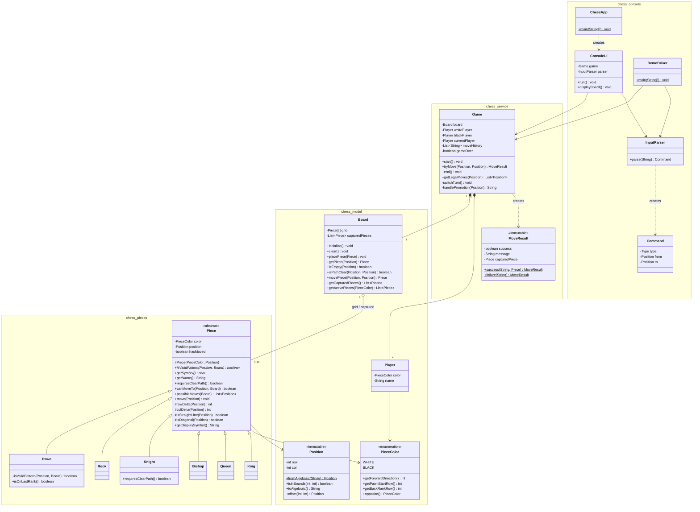

# UML Class Diagram (source)

Paste the block below into https://mermaid.live, export a PNG/SVG, and put it in your report.
Keep it in sync with the code. If you add or rename methods, update this file.

